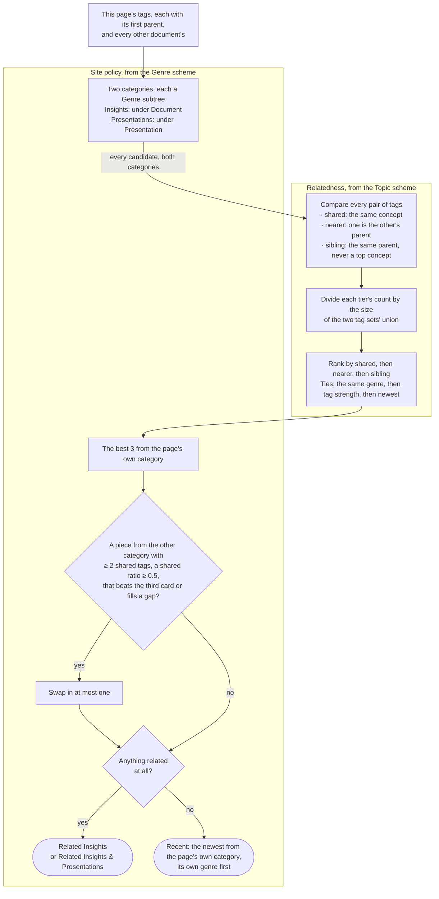

# How related content is chosen

What the "Related" band on every insight and presentation page shows, and how the build picks
it. Written 2026-11-24, when the cross-category ranker replaced the old branch rule. The research
behind every rule here, and the record of how it shipped, are in
[recommendations/](recommendations/README.md).

---

## Tags in, three cards out

Each page's list comes from its **Topic tags** alone, ranked at build time with no semantic
search. Relatedness comes from the Topic scheme; which documents may appear, and in what order
when they tie, is site policy built on the Genre scheme.

**The tags are written by hand in the Studio today.** Most of them are the research's v5 tags,
written into `production-26` when stream 1 rebuilt it; pieces published since are tagged by Andy.
Assisted tagging, which also supplies a score for each tag, is the Taxonomy Manager plugin's work
(stream 3). Until it lands, **no tag carries a score.** The ranker treats a score as optional, so
nothing here waits for it.

## The rules, and what each is for

- **Nearest common ancestor, never a top concept.** Two tags relate if they are the same concept
  (*shared*), if one is the other's parent (*nearer*, in either direction), or if they share a
  parent (*sibling*). A shared parent that is a top concept counts for nothing: two mid-level tags
  "somewhere under Design Practices" are not related.
- **Ratios, not counts.** Each tier is divided by the size of the two tag sets' union, so two
  pieces with two tags sharing both outrank two with ten tags sharing two.
- **Lexicographic.** Any shared tag outranks any amount of nearer and sibling, so no weights have
  to be invented.
- **A tag's first parent only.** SKOS leaves `skos:broader` unordered; the pool query projects
  `broader[0]`, so a concept with two parents relates through the first. Genres are different:
  the categories walk every parent, to any depth.
- **Two categories, and crossing only on a strong match.** Insights is the whole Document subtree
  of the Genre scheme, notes included, so a note and an article relate. A presentation can take
  one card on an insight's page, and an insight one on a presentation's, only if it shares at
  least 2 tags at a shared ratio of at least 0.5 and strictly beats the card it replaces or fills
  a gap. Nearer and sibling never cross.
- **Ties: genre, then tag strength, then date.** The page's own genre first, then the sum of the
  weaker score on each shared tag, then the newest. Strength adds nothing until tags carry
  scores, so today ties break by genre, then date.
- **The heading names what the cards are,** read off the cards: "Related Insights",
  "Related Insights & Presentations", and the same for presentations. **Each card links to its
  own collection,** so a presentation card on an insight page goes to `/presentations/…`.
- **The fallback** shows the newest documents in the page's own category, its own genre first,
  under "Recent Insights" or "Recent Presentations". On 2026-11-24 one page takes it, *The Calm
  Before the Storm*.

## Where it lives

| Part | Where |
|---|---|
| The ranker: `rankAcross`, the categories, `CROSS_RULE` and `RANK_RULE` | `web/src/lib/related.ts` |
| Genre subtrees | `web/src/lib/genres.ts` → `subtree` |
| The pool: every publishable document, each tag's first parent, and the Genre tree | `web/src/sanity/queries/related.ts` → `RELATED_POOL_QUERY` |
| The band: heading, cards, links | `web/src/components/bands/RelatedBand.astro` |
| The two consumers | `web/src/pages/insights/[slug].astro`, `web/src/pages/presentations/[slug].astro` |
| One rule per test, on a made-up taxonomy | `web/src/lib/related.test.ts` |
| Whole lists on the 73 judged documents | `web/src/lib/related.golden.test.ts`, its fixture `related.golden.json` and snapshot `related.golden.test.ts.snapshot` |

## Changing it

- **The golden test is the review.** It checks two things: with the research's v5 scores, every
  list equals the column Andy judged; without scores, under `RANK_RULE`, every list matches a
  snapshot he reviewed page by page. Changing a value in `CROSS_RULE`, or any rule above, changes
  that snapshot. Regenerate it deliberately, with
  `cd web && node --test --test-update-snapshots src/lib/related.golden.test.ts`, and review its
  diff as the list of pages that will change.
- **The fixture is frozen.** It records the corpus the research judged. Its generator and sources
  left the repository; the fixture names the commit where they can still be read.
- **When scores arrive** from the plugin, they will ride on each topic as `score`, and the pool
  query will project them from wherever the plugin stores them. That read contract is part of
  stream 3's design. The v5 half of the golden test already covers ranking with scores.
